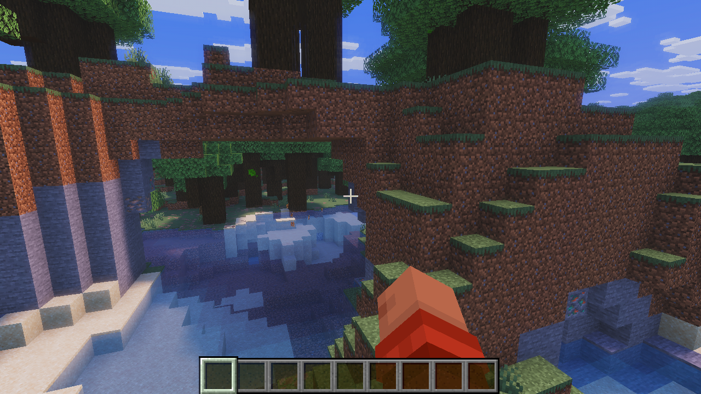
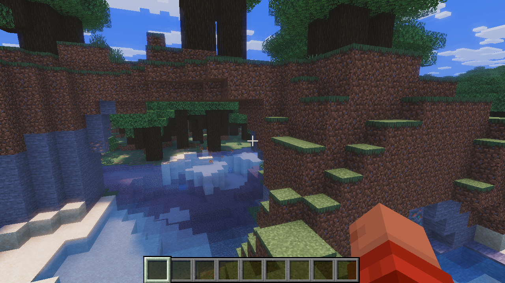
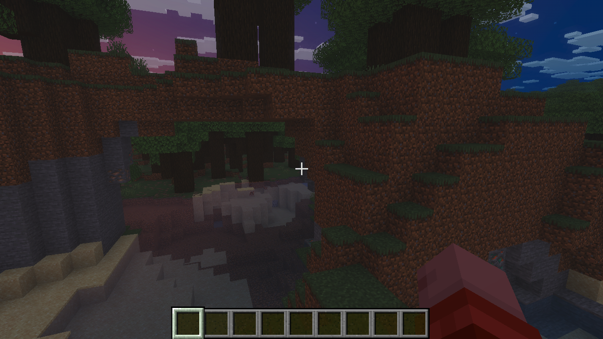
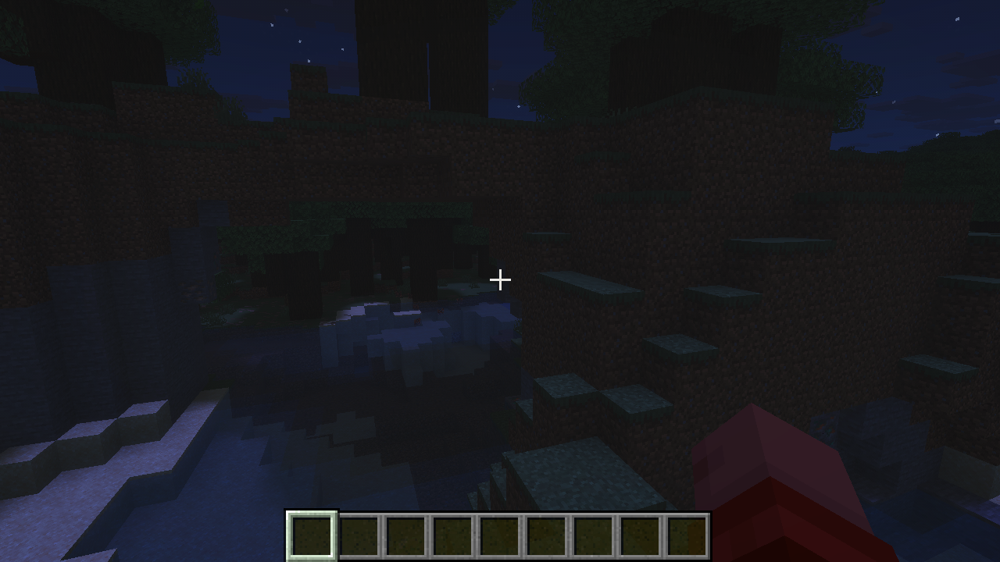
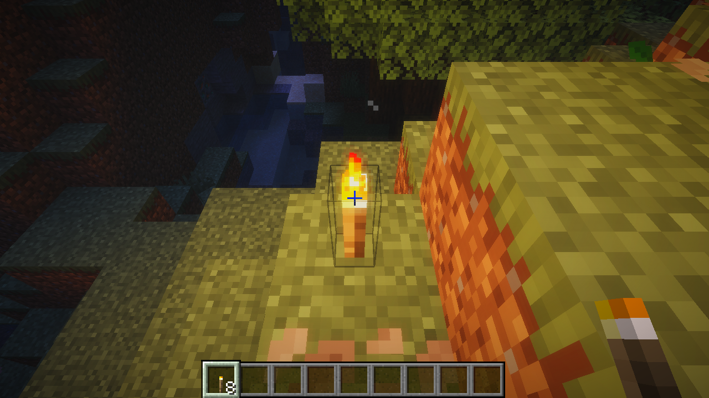
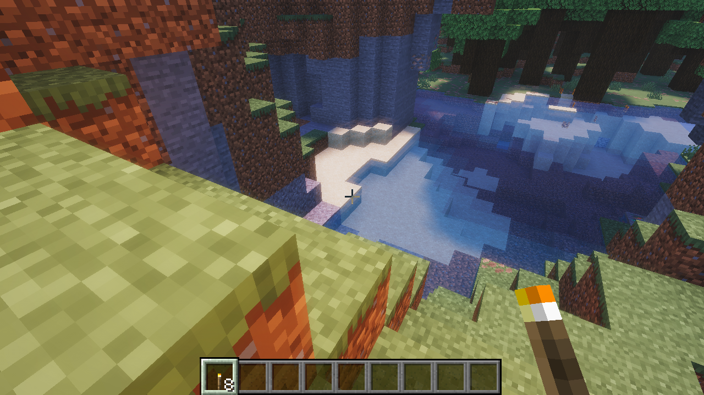
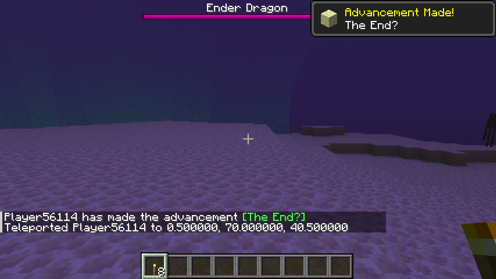
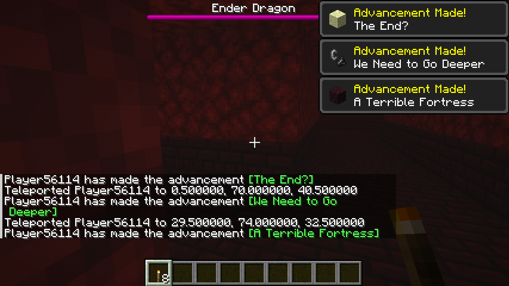

# Agugus Shaders (Stable) — a native Horizon shader pack

A **native Horizon `.hshader` shader pack** for **shader API 0.1** — the line
served by Horizon's **stable releases** (`v0.2.97` and its era).

Soft pastel light, two-colour sky gradients through the day, warm
torchlight, fancy water with sky reflections, atmospheric fog, bloom and a
gentle grade — all three dimensions included.

> **Heads-up:** this pack is for the **0.1 API line only**. Newer Horizon
> builds (nightly-2026-11-18 and later) serve shader API **0.2** and refuse
> 0.1 packs; a shader API 0.2 edition of Agugus Shaders exists for that line
> and will be published separately.

## Install

1. Download [`agugus_shaders_stable-1.0.0.hshader`](https://github.com/Aramis420/agugus-shaders-horizon/releases/latest)
   from the releases (or clone this repo and take the `agugus_shaders_stable/` folder).
2. Put it into the game's `shaderpacks/` folder (in the Horizon game home,
   beside `saves/` and `options.txt`).
   - The `.hshader` file and the unpacked folder both work — but don't put a
     zip *inside* the pack folder; the shader screen treats nested packs as
     stray entries.
3. Launch the game → **Options → Horizon Settings → Shader Packs** →
   pick **"Agugus Shaders (Stable)"** → ON.

## What you get

- Two-colour sky gradient with sun glare, from dawn through night
- Pastel time-of-day ambients and warm, flickerable torch light
- Soft shadows from sky light
- Fancy water: the pack's colour over the biome tint, wave normals, fresnel,
  sky reflection with a sun glint
- Atmospheric mist, border fade, underwater tint, blindness/darkness fog
- Bloom, and optional godrays, SSAO, film grain, vignette, CAS sharpening
- Custom ambients for the Nether, and the End's aurora sky
- Four colour schemes, four tonemap operators, and ~40 in-pack options
  (exposure, torch tint, water colour set, bloom curve, …)

Stage-by-stage details, the options and what the 0.1 API line supports:
[`agugus_shaders_stable/README.md`](agugus_shaders_stable/README.md).

## Screenshots

Verified in-game on v0.2.97:

| | |
|---|---|
|  |  |
|  |  |
|  |  |
|  |  |

## License

MIT — see [LICENSE](LICENSE). Agugus Shaders by **Agugus**.
